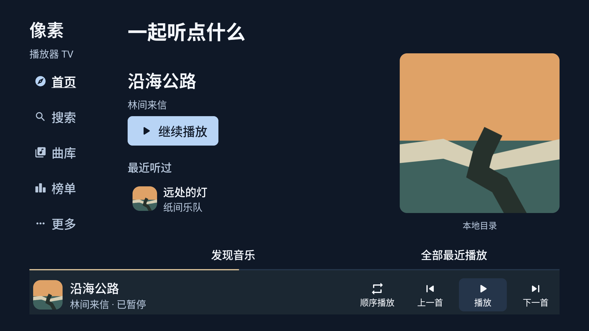
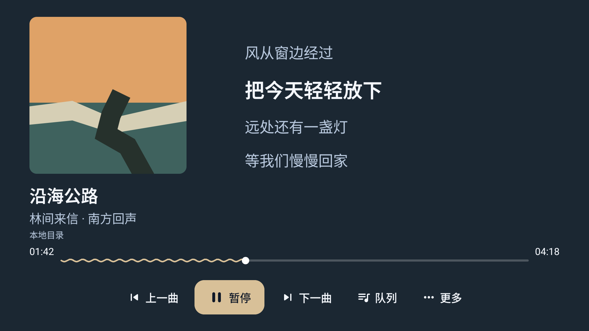

# 像素播放器 TV

为 Android TV 与电视盒子设计的音乐播放器，使用遥控器找歌、听歌和看歌词。

**v2.1.0 preview** · Android 5.0+ · Kotlin / Jetpack Compose · [GPL-3.0](LICENSE)

同一品牌，不同终端；视觉同源，体验独立。TV 版延续安卓版的封面动态配色和柔和的音乐表达，采用独立的横屏布局、文字导航与遥控器焦点交互。

[下载与版本记录](https://github.com/HZX0831/XiangSuPlayer_for_TV/releases) · [安卓版主项目](https://github.com/r3n011/XiangsuPlayerHQ) · [设计规范](DESIGN.md) · [验收记录](docs/design/IMPLEMENTATION-REVIEW.md)

## 界面

| 首页 | 全屏播放 |
| --- | --- |
|  |  |

截图来自原生 Compose 页面和确定性测试数据。真实在线服务的验证范围单独记录在验收记录中。

## 功能

| 入口 | 能力 |
| --- | --- |
| 首页与发现 | 继续播放、最近播放、推荐歌曲与歌单、地区新歌、私人 FM、心动模式。私人内容依赖网易云账号及服务可用性。 |
| 搜索与榜单 | 全平台或网易云、QQ、酷狗、酷我、咪咕歌曲搜索；歌单检索、热搜、搜索历史；网易云、QQ、酷狗内置榜单。歌名、歌手、专辑可作为关键词，没有独立歌手／专辑详情页。 |
| 曲库 | 本地歌曲收藏、网易云红心同步、个人歌单和音乐云盘；QQ 公开资料关联与公开歌单；酷狗入口提供公开榜单。 |
| 目录 | 通过系统目录选择器授权内置存储或 U 盘，或添加只读 HTTPS WebDAV；支持 MP3、FLAC、M4A、目录层级和分页。服务器不支持 Range 时提示无法定位进度。 |
| 播放与队列 | 前后台播放、暂停／恢复、上下首、顺序／单曲循环／随机／心动模式；可取消的进度定位、手动换源、四档请求音质；队列选曲、设为下一首、移除与清空。冷启动暂停恢复队列，按播放后再取流。 |
| 歌词与评论 | LRC、译文、纯歌词、网易云 YRC 逐字时间与普通行回退；热门评论阅读。跨平台评论按曲名与歌手匹配，仍可能存在版本差异。 |
| 手机输入与点歌 | 同网扫码输入搜索词；独立点歌队列和双行歌词。进入点歌暂存普通队列，退出后恢复并暂停。没有录音、评分或伴奏功能。 |
| 音源与设置 | 市场、HTTPS 地址导入、安装／替换／启停／测速／卸载；默认音质、每日或自定义壁纸、遮罩浓度、旧版 HTTP 兼容开关。 |

网易云支持扫码登录；QQ 支持扫码或 QQ 号关联**公开资料**，不等同于完整私有账号授权。歌单部分加载成功时，可先播放已加载曲目，再重试补充。

## 遥控器

| 操作 | 行为 |
| --- | --- |
| 方向键 | 移动焦点。左侧五个栏目上下滚动，确定后打开；移动焦点不会开始播放。 |
| 确定 | 执行当前动作；输入框聚焦后，按确定才进入编辑。 |
| 返回 | 优先退出键盘或最上层面板，再返回上级；关闭面板后恢复调用项。 |
| 进度定位 | 聚焦进度条后按确定进入预览，左右调整；再次确定跳转，返回取消。 |
| 底部播放条 | 模式、上下首、播放／暂停；选择曲目信息进入全屏播放器。 |
| 纯歌词 | 播放器“更多”中开启；方向键唤回控制，首次按键不同时切歌。 |

基本操作不依赖菜单键、触屏或手机。低分辨率和大字号切换紧凑布局，五个主栏目及播放控制仍保留。

## 安装与兼容

在[Releases](https://github.com/HZX0831/XiangSuPlayer_for_TV/releases)选择 APK，通过电视文件管理器安装，或使用 ADB：

```text
adb connect <电视IP>:5555
adb install -r <下载的APK路径>
```

应用 ID 为 `com.cutedino.xiangsuplayer`。覆盖安装要求签名一致；签名不匹配时请先核对安装包来源，避免卸载丢失本地数据。

这是预览版。在线服务依赖第三方接口；可用性与音质取决于账号、版权、地区、音源和设备。请求音质不是实际解码质量的保证。

音源导入不会执行任意 JavaScript。HTTP 模板需有效 HTTPS `@apiBaseUrl`；其他脚本可保留，但不保证可播放。下载、单脚本及解压均有大小限制。旧版 HTTP 开关仅适用于预设的无认证音源。

## 构建与测试

使用 JDK 21、SDK Platform 36 和自带 Gradle 8.13。`compileSdk 36`、`targetSdk 34`、`minSdk 21`，JVM 目标 17。在 `local.properties` 配置本机 SDK 路径。

Windows：

```powershell
.\gradlew.bat :app:assembleDebug :app:assembleDebugAndroidTest
.\gradlew.bat :app:testDebugUnitTest :ncmapi:testDebugUnitTest
.\gradlew.bat :app:lintDebug :ncmapi:lintDebug
.\gradlew.bat :app:assembleRelease
```

macOS / Linux 使用 `./gradlew`。调试 APK：`app/build/outputs/apk/debug/app-debug.apk`。Release 默认输出未签名 APK，发布前需正式签名并验证；不要提交密钥、密码或本地签名配置。

```text
app/src/main/java/com/cutedino/xiangsuplayer/
  core/           播放、歌词、音源、目录与手机输入
  data/           数据库、会话与平台账号
  ui/main/        首页、搜索、曲库、榜单与设置
  ui/player/      全屏播放与双行点歌
  ui/library/     歌单详情
  ui/components/  共享 TV 控件与输入
  ui/theme/       主题、窗口规格与焦点导航
app/src/test/     JVM 回归
app/src/androidTest/ 原生截图与设备回归
ncmapi/           网易云接口模块
docs/design/      品牌研究、设计与验收证据
```

CI 在推送 main 或提交 PR 时运行调试构建、JVM 测试与 Lint。设备验收覆盖 960×540dp、640×360dp、1.0／1.3 字号和 D-pad 路径。具体通过记录及尚未验证的真机、账号、手机、WebDAV 场景见[验收记录](docs/design/IMPLEMENTATION-REVIEW.md)。

## 作者与鸣谢

- **Android 主项目作者：R3n_011** — [XiangsuPlayerHQ](https://github.com/r3n011/XiangsuPlayerHQ)。
- **TV 原维护者：cutedino**。
- **TV 现维护者：HZX0831** — [XiangSuPlayer_for_TV](https://github.com/HZX0831/XiangSuPlayer_for_TV)。
- **鸣谢：暮间雾、忘羡**，以及 LX Music 开源社区、Moriafly 与 NeteaseCloudMusicApi 等项目的贡献者。

## 许可

本仓库按 [GNU General Public License v3.0](LICENSE) 提供源码。音乐版权归各权利人所有，请遵守平台条款并支持正版服务。
